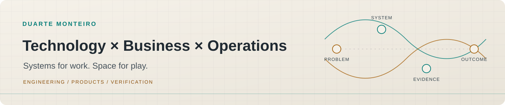
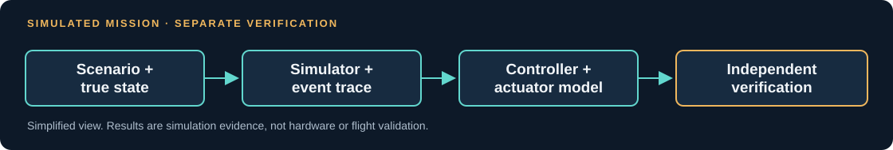
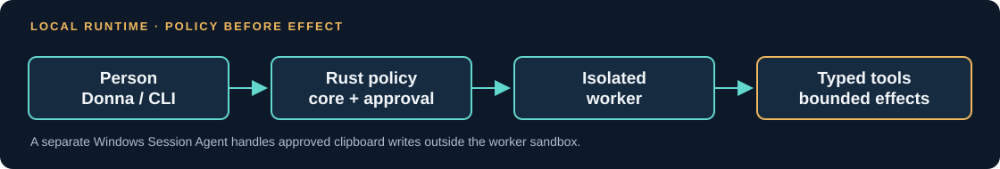
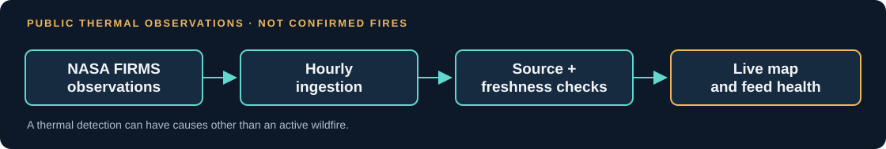
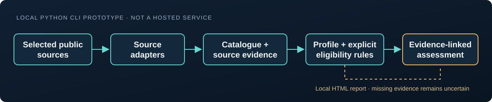
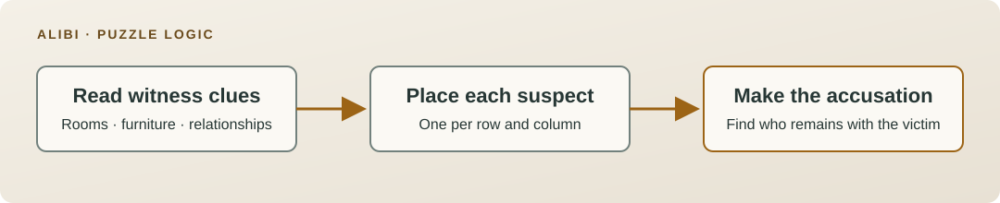
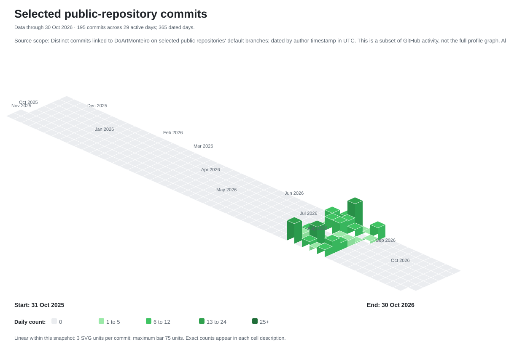
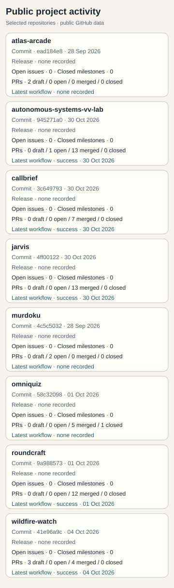

<picture>
  <source media="(prefers-color-scheme: dark)" srcset="assets/identity/night-atlas-dark.svg">
  <source media="(prefers-color-scheme: light)" srcset="assets/identity/night-atlas-light.svg">
  
</picture>

# Duarte Monteiro

**Technology × Business × Operations**
Industrial Engineering & Management, consulting experience, and independently initiated software and engineering projects.

*Systems for work. Space for play.*

I identify practical problems, build systems around their constraints, and use evidence to make decisions and trade-offs clear.

[Engineering projects](#engineering) · [Games and experiments](#creative-work) · [Project index](#project-index) · [GitHub activity](#activity)

## Engineering

### [Autonomous Systems V&V Lab](https://github.com/DoArtMonteiro/autonomous-systems-vv-lab)

Repeatable simulation and verification for autonomous missions. The system separates controller observations from verified state, replays seeded faults and checks event traces with a separate verifier.

- **Status:** M9 and M9.1 are integrated in main. M10.0 remains an architecture and design package under review; its implementation and campaign have not started.
- **Evidence:** The public results report records 780 M9 runs and 1,050 M9.1 runs. The raw campaign outputs are not in public main, so these remain project-reported totals. [M9 CI checks](https://github.com/DoArtMonteiro/autonomous-systems-vv-lab/actions/runs/40852112731) passed Linux and Windows.
- **Explore:** [Full architecture diagram](assets/diagrams/vv-architecture.svg) · [M9 results](https://github.com/DoArtMonteiro/autonomous-systems-vv-lab/blob/main/docs/m9-powered-landing.md) · [Reproduction guide](https://github.com/DoArtMonteiro/autonomous-systems-vv-lab/blob/main/docs/reproducibility.md) · [M9 integration, PR #12](https://github.com/DoArtMonteiro/autonomous-systems-vv-lab/pull/12) · [M10.0 design under review, PR #13](https://github.com/DoArtMonteiro/autonomous-systems-vv-lab/pull/13)

### [JARVIS / Donna](https://github.com/DoArtMonteiro/jarvis)

A local assistant runtime with a Rust policy core, typed tools, scoped approvals and an OS-isolated worker. Donna is its desktop client; a separate Windows Session Agent handles approved clipboard writes.

- **Status:** Local prototype. M7 reliability and privacy work and Donna Experience V1 are merged in main. It is not a general autonomous assistant.
- **Engineering focus:** The Core owns policy, approvals, durable state and tool execution. The worker cannot grant itself permissions. Windows privacy boundaries and known gaps are documented.
- **Explore:** [Full architecture diagram](assets/diagrams/jarvis-architecture.svg) · [Threat model](https://github.com/DoArtMonteiro/jarvis/blob/main/docs/threat-model.md) · [Windows validation](https://github.com/DoArtMonteiro/jarvis/blob/main/docs/windows-validation.md)

### [WildfireWatch](https://github.com/DoArtMonteiro/wildfire-watch)

A live map for sampled NASA FIRMS thermal observations, with source provenance, hourly ingestion and feed-health reporting.

- **Status:** Live demo, deployed from main.
- **Limit:** A thermal detection is not a confirmed fire. Freshness, derived estimates and unknown operational status remain distinct.
- **Explore:** [Live map](https://wildfire-watch.duartemonteiro.workers.dev) · [Full data-flow diagram](assets/diagrams/wildfirewatch-dataflow.svg) · [Data and operations](https://github.com/DoArtMonteiro/wildfire-watch/blob/main/README.md)

### [CallBrief](https://github.com/DoArtMonteiro/callbrief)

A local Python prototype for funding-opportunity research and evidence-linked eligibility checks. Source facts, organisation profiles and explicit rules remain separate; missing or unsupported evidence stays uncertain.

- **Status:** The public main branch is a command-line prototype. The approved desktop-first product direction is not implemented as an application.
- **Evidence:** The 59-query development evaluation uses manually prepared labels that were not independently reviewed. It does not establish production accuracy or predict funding outcomes. Some source-reuse conditions still need confirmation.
- **Explore:** [Evaluation and current scope](https://github.com/DoArtMonteiro/callbrief/blob/main/README.md) · [Source coverage and reuse limits](https://github.com/DoArtMonteiro/callbrief/blob/main/README.md#current-source-coverage)

## Creative work

### [Atlas Arcade](https://github.com/DoArtMonteiro/atlas-arcade)

A browser arcade of geography games built around quick rounds and varied ways to explore places and data.

- **Status:** Public demo.
- **Limit:** Scores are not server-verified, so the leaderboard is not an authoritative competitive record.
- **Explore:** [Play Atlas Arcade](https://atlasarcade.app) · [Browse the source](https://github.com/DoArtMonteiro/atlas-arcade)

### [Murdoku / Alibi](https://github.com/DoArtMonteiro/murdoku)

A deduction game where witness clues constrain suspect positions on a house map until only the suspect left with the victim can be accused.

- **Status:** Live demo. The published game is branded Alibi; the repository remains Murdoku.
- **Explore:** [Play Alibi](https://murdoku-seven.vercel.app) · [Browse the source](https://github.com/DoArtMonteiro/murdoku)

### [OMNIQUIZ](https://github.com/DoArtMonteiro/omniquiz)

A free, account-free browser trivia game where uncommon recognised answers score more. Four modes and themed packs share a deterministic scoring engine; the answer atlas stays server-side.

[Play the live demo](https://omniquiz-nine.vercel.app)

## Project index

**Engineering:** [Autonomous Systems V&V Lab](https://github.com/DoArtMonteiro/autonomous-systems-vv-lab) · [JARVIS / Donna](https://github.com/DoArtMonteiro/jarvis) · [WildfireWatch](https://github.com/DoArtMonteiro/wildfire-watch) · [CallBrief](https://github.com/DoArtMonteiro/callbrief)

**Games:** [Atlas Arcade](https://github.com/DoArtMonteiro/atlas-arcade) · [Murdoku / Alibi](https://github.com/DoArtMonteiro/murdoku) · [OmniQuiz](https://github.com/DoArtMonteiro/omniquiz)

**Other experiments:** [Roundcraft](https://github.com/DoArtMonteiro/roundcraft)

## Activity

The 3D calendar is a focused engineering-activity view, not a replica of GitHub's native contribution graph. It counts distinct commits linked to this account in the default branches of eight selected public repositories. The snapshot through 30 October 2026 contains 195 commits across 29 active days. It excludes other repositories and contribution types.

GitHub's [native profile calendar](https://github.com/DoArtMonteiro?tab=overview#js-contribution-activity) remains the broader account view. The separate [GraphQL preview generator](docs/living-portfolio.md#github-contribution-calendar) uses GitHub's public contribution-calendar API; its output is not presented here as a current profile image until a complete refresh has been reviewed.

<picture>
  <source media="(prefers-color-scheme: dark) and (prefers-reduced-motion: no-preference)" srcset="assets/generated/current/calendar-dark-animated.gif">
  <source media="(prefers-color-scheme: dark)" srcset="assets/generated/current/calendar-dark.svg">
  <source media="(prefers-color-scheme: light) and (prefers-reduced-motion: no-preference)" srcset="assets/generated/current/calendar-light-animated.gif">
  <source media="(prefers-color-scheme: light)" srcset="assets/generated/current/calendar-light.svg">
  
</picture>

[Accessible 2D calendar](assets/generated/current/calendar-accessible.svg) · [Daily counts CSV](assets/generated/current/calendar-normalized.csv) · [Snapshot freshness](assets/generated/current.json) · [Data provenance](assets/generated/current/provenance.json)

<picture>
  <source media="(max-width: 480px) and (prefers-color-scheme: dark)" srcset="assets/generated/current/projects-dashboard-mobile-dark.svg">
  <source media="(max-width: 480px) and (prefers-color-scheme: light)" srcset="assets/generated/current/projects-dashboard-mobile-light.svg">
  <source media="(prefers-color-scheme: dark)" srcset="assets/generated/current/projects-dashboard-dark.svg">
  <source media="(prefers-color-scheme: light)" srcset="assets/generated/current/projects-dashboard-light.svg">
  
</picture>

[Full project activity report](assets/generated/current/projects-activity.md) · [Project activity data](assets/generated/current/projects-activity.json)

These are dated snapshots for review. Scheduled refresh and public asset publication are not active. Treat the visuals as stale after the 36-hour limit in the [snapshot metadata](assets/generated/current.json). Neither view measures work quality or business impact. Data sources, update rules and recovery limits are described in the [living portfolio guide](docs/living-portfolio.md).

## Toolkit and contact

- **Systems and verification:** Rust, Python, simulation and automated checks.
- **Product engineering:** TypeScript, Next.js and Supabase.
- **Delivery:** GitHub Actions and Cloudflare Workers.
- **Contact:** [GitHub profile](https://github.com/DoArtMonteiro).
