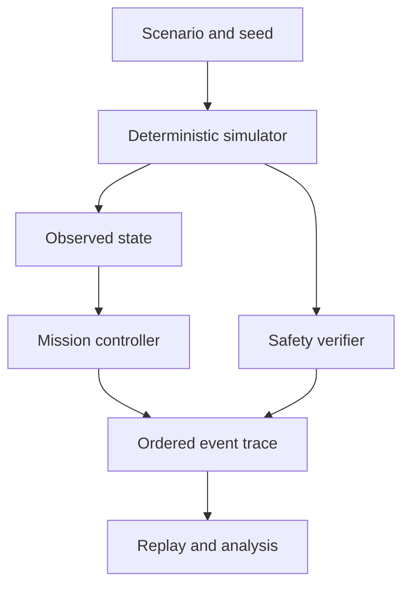

# Duarte Monteiro

**Technology · business · operations**

An Industrial Engineering & Management background and consulting experience inform how I frame problems, build software and assess evidence. I work on practical systems where operational constraints and engineering trade-offs matter.

[Engineering](#engineering) · [Evidence](#campaign-evidence) · [Made for play](#made-for-play) · [Project index](#project-index)

## Engineering

### [Autonomous Systems V&V Lab](https://github.com/WhiteBlindness/autonomous-systems-vv-lab)

A deterministic simulation lab for autonomous missions, fault injection and replayable safety findings. M9 and M9.1 are integrated. M10.0 remains an architecture and design proposal under review in [PR #13](https://github.com/WhiteBlindness/autonomous-systems-vv-lab/pull/13).

In short: a scenario and seed drive the simulator; the controller acts on observations, while a separate verifier checks the simulated state. The event trace supports replay.

### Campaign evidence

M9 reports 780 runs; M9.1 reports 1,050. These totals are project-reported, and raw campaign outputs are not in public `main`. The rocket model is idealised simulation, not flight validation. [Results and assumptions](https://github.com/WhiteBlindness/autonomous-systems-vv-lab/blob/main/docs/m9-powered-landing.md) · [M9 integration PR](https://github.com/WhiteBlindness/autonomous-systems-vv-lab/pull/12)

### Other engineering work

- **[JARVIS / Donna](https://github.com/WhiteBlindness/jarvis)** is a local assistant runtime with a Rust policy core, scoped approvals and an isolated worker. Donna V1 is merged; Windows privacy limitations are documented. [Architecture](https://github.com/WhiteBlindness/jarvis/blob/main/docs/architecture.md) · [Threat model](https://github.com/WhiteBlindness/jarvis/blob/main/docs/threat-model.md)
- **[WildfireWatch](https://github.com/WhiteBlindness/wildfire-watch)** maps sampled NASA FIRMS thermal detections with source and data-freshness context. A detection is an observation, not a confirmed fire. [Open the map](https://wildfire-watch.duartemonteiro.workers.dev)
- **[CallBrief](https://github.com/WhiteBlindness/callbrief)** is a local CLI prototype for funding-opportunity research and evidence-linked eligibility checks. Its small manual evaluation does not establish production accuracy. [Evaluation](https://github.com/WhiteBlindness/callbrief#evaluation-evidence)

## Made for play

Games and experiments have their own section, with demo links where available.

- **[OmniQuiz](https://github.com/WhiteBlindness/omniquiz)** is a browser quiz with multiple game modes and content packs. [Play](https://omniquiz-nine.vercel.app)
- **[Murdoku / Alibi](https://github.com/WhiteBlindness/murdoku)** is a clue-based logic game. [Play](https://murdoku-seven.vercel.app)
- **[Atlas Arcade](https://github.com/WhiteBlindness/atlas-arcade)** is a set of geography games. Scores and balances remain client-writable, so competitive results are not tamper-proof. Draft [PR #2](https://github.com/WhiteBlindness/atlas-arcade/pull/2) proposes a documentation disclosure; server-side integrity work remains outstanding.

## Project index

- **In development:** [Roundcraft](https://github.com/WhiteBlindness/roundcraft), a Counter-Strike 2 decision-practice tool. Production cases still need human tactical review.
- **Engineering:** [Autonomous Systems V&V Lab](https://github.com/WhiteBlindness/autonomous-systems-vv-lab) · [JARVIS / Donna](https://github.com/WhiteBlindness/jarvis) · [WildfireWatch](https://github.com/WhiteBlindness/wildfire-watch) · [CallBrief](https://github.com/WhiteBlindness/callbrief)
- **Games and experiments:** [Atlas Arcade](https://github.com/WhiteBlindness/atlas-arcade) · [Murdoku / Alibi](https://github.com/WhiteBlindness/murdoku) · [OmniQuiz](https://github.com/WhiteBlindness/omniquiz)

**Core tools:** Rust · Python · TypeScript
