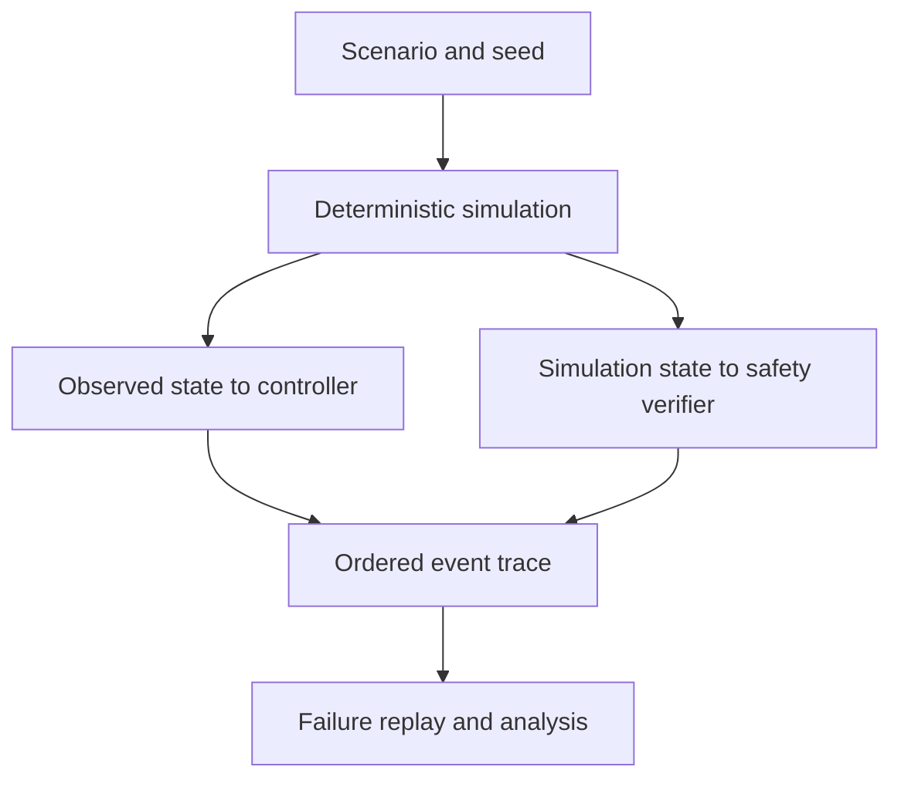

# Systems for work. Space for play.

I bring an Industrial Engineering & Management background and consulting experience to software and AI implementation. My projects connect operational problems with practical systems, clear trade-offs and evidence.

**[Engineering work](#engineering) · [Games and experiments](#made-for-play) · [Project index](#more-to-explore)**

## Engineering

### Autonomous Systems V&amp;V Lab

A deterministic simulation lab for autonomous mission scenarios, seeded fault injection and failure replay against a separate safety verifier.

Flow: scenario and seed → deterministic simulation → controller observations and verifier checks → ordered event trace → failure replay and analysis.

**M9 and M9.1 are integrated.** Project documentation reports 780 M9 runs and 1,050 M9.1 runs; raw campaign outputs are not in public `main`. The rocket model is an idealised simulation, not flight validation. M10.0 remains an architecture and design proposal under review in [PR #13](https://github.com/WhiteBlindness/autonomous-systems-vv-lab/pull/13).

[Read the results and assumptions](https://github.com/WhiteBlindness/autonomous-systems-vv-lab/blob/main/docs/m9-powered-landing.md) · [Explore the repository](https://github.com/WhiteBlindness/autonomous-systems-vv-lab)

### JARVIS / Donna

A local assistant prototype with a Rust policy core, scoped human approvals and an OS-isolated worker. Donna V1 is merged; documented Windows privacy limitations remain.

[Architecture](https://github.com/WhiteBlindness/jarvis/blob/main/docs/architecture.md) · [Threat model](https://github.com/WhiteBlindness/jarvis/blob/main/docs/threat-model.md) · [Repository](https://github.com/WhiteBlindness/jarvis)

### WildfireWatch

A map of sampled NASA FIRMS thermal detections, with source provenance and feed-freshness context. A detection is an observation, not a confirmed fire; feeds can be stale.

[Open the map demo](https://wildfire-watch.duartemonteiro.workers.dev) · [Repository](https://github.com/WhiteBlindness/wildfire-watch)

### CallBrief

A local CLI prototype for funding-opportunity research and evidence-linked eligibility checks. Its small manual evaluation does not establish production accuracy.

[Evaluation notes](https://github.com/WhiteBlindness/callbrief#evaluation-evidence) · [Repository](https://github.com/WhiteBlindness/callbrief)

## Made for play

Games and experiments have their own space here. They are a way to explore interaction, systems and feedback through working products.

  

OmniQuiz · themed worlds and quiz modes in a browser game.

- **[Murdoku / Alibi](https://github.com/WhiteBlindness/murdoku):** a clue-based logic game. [Play the demo](https://murdoku-seven.vercel.app).
- **[OmniQuiz](https://github.com/WhiteBlindness/omniquiz):** browser trivia with different modes and content packs. [Play the demo](https://omniquiz-nine.vercel.app).
- **[Atlas Arcade](https://github.com/WhiteBlindness/atlas-arcade):** geography mini-games. Scores and balances remain client-writable, so competitive results are not tamper-proof. [Draft PR #2](https://github.com/WhiteBlindness/atlas-arcade/pull/2) proposes a documentation disclosure; server-side integrity work remains outstanding.

## More to explore

- **[Roundcraft](https://github.com/WhiteBlindness/roundcraft):** Counter-Strike 2 decision-practice project in development; production cases still need human tactical review.
- **[Full repository list](https://github.com/WhiteBlindness?tab=repositories)**

**Core tools:** Rust · Python · TypeScript
